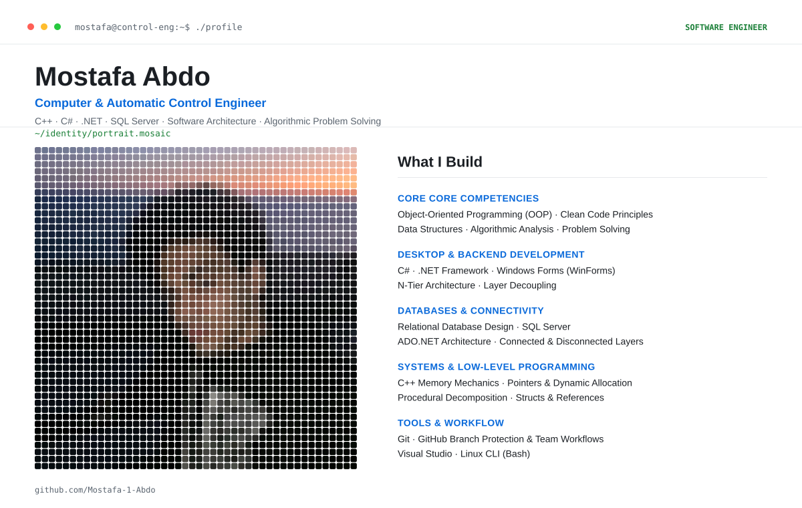

<picture>
  <source media="(prefers-color-scheme: dark)" srcset="./dark_mode.svg">
  <source media="(prefers-color-scheme: light)" srcset="./light_mode.svg">
  
</picture>

 

  

 

## 🧭 About Me

I'm a **Computer & Automatic Control Engineering Student** focused on building robust, scalable desktop applications and engineering software. My focus spans low-level C++ logic, modern C#/.NET practices, relational database design, and multi-tier application architectures.

- 🔭 Currently building: **Multi-tier desktop software and database connectivity solutions**
- 🧠 Focused on: **Object-Oriented Programming (OOP), Data Structures, and Clean Layer Decoupling**
- 🌱 Learning: **Machine Learning and Advanced Software Architecture**
- 💬 Ask me about: **C++, C#, ADO.NET, SQL Server, and Git workflows**

 

## 🛠️ Tech Stack

**Languages**

**Frameworks & Architecture**

`N-Tier Architecture` `ADO.NET` `Data Structures` `OOP`

**Tools & Workflow**

 

## 📊 GitHub Stats

 

## 🎓 Education & Training

| | |
|---|---|
| 🎓 **Computer & Automatic Control Engineering Student** — Tanta University | Expected 2028 |
| 🤖 **Machine Learning Program** — Digital Egypt Pioneers Initiative (DEPI) | Participant |

 

## 🐍 Contribution Graph

<picture>
  <source media="(prefers-color-scheme: dark)" srcset="https://raw.githubusercontent.com/Mostafa-1-Abdo/Mostafa-1-Abdo/output/github-contribution-grid-snake-dark.svg">
  <source media="(prefers-color-scheme: light)" srcset="https://raw.githubusercontent.com/Mostafa-1-Abdo/Mostafa-1-Abdo/output/github-contribution-grid-snake.svg">
  
</picture>

 

### Let's Connect

&nbsp;&nbsp;

